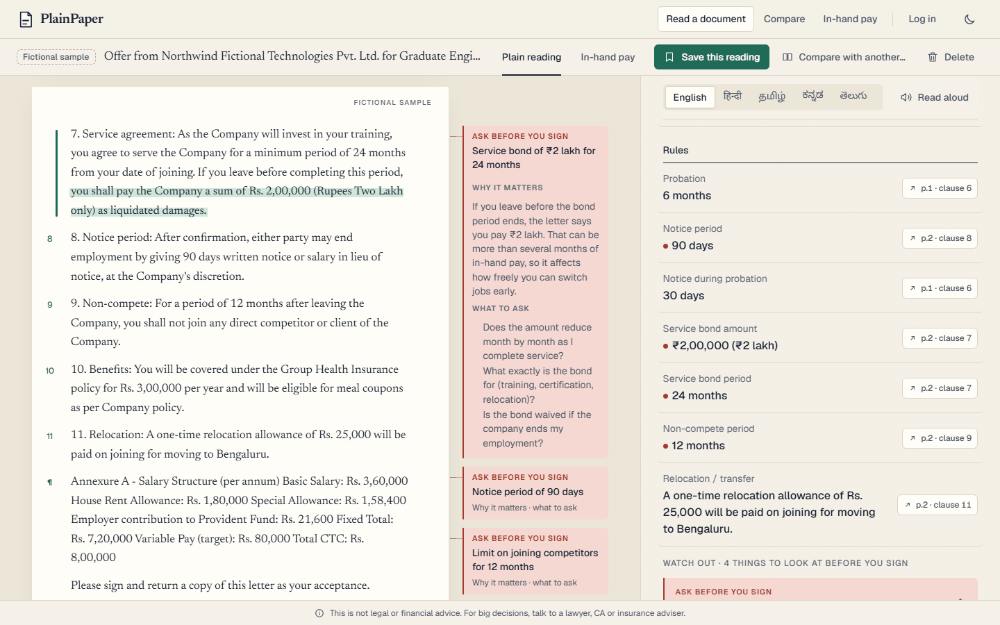
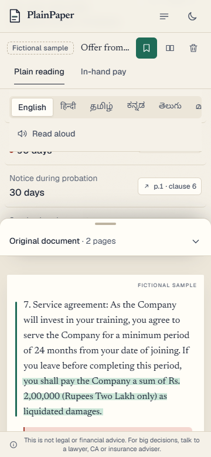
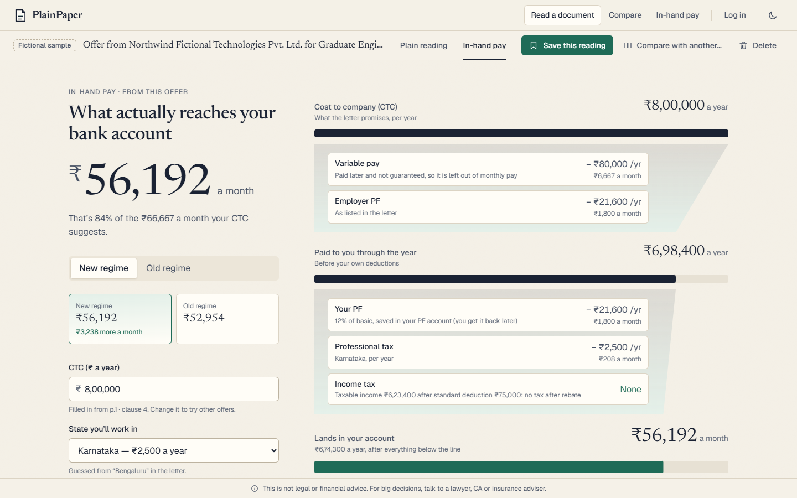
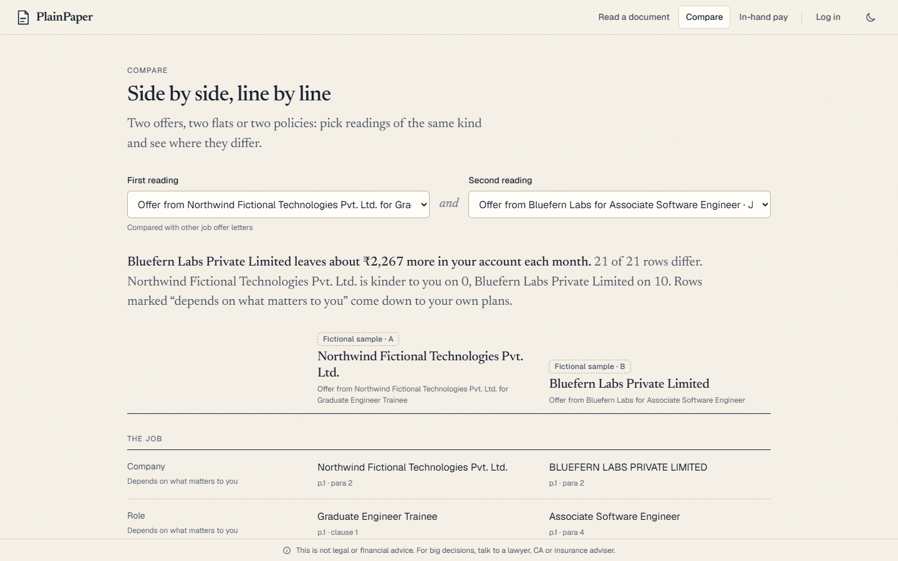
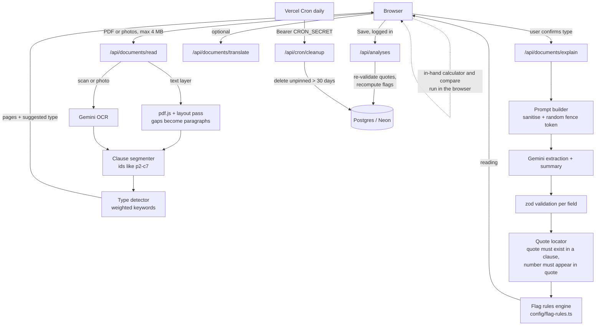

# PlainPaper

**The fine print, made plain.** PlainPaper explains job offer letters, rent agreements and health insurance policies in plain language, in English or seven Indian languages, before you sign them.

**Live demo:** TODO: add the Vercel link after deploying.
**Static preview (GitHub Pages):** https://devkeerthi-code.github.io/plainpaper/

> This is not legal or financial advice. PlainPaper helps you read; for big decisions, talk to a lawyer, CA or insurance adviser.

## Who is this for and what problem does it solve?

- **Students signing their first offer letter.** They see "₹8 LPA" but not the in-hand pay, the ₹2 lakh service bond, or the 90-day notice period.
- **Tenants signing an 11-month rent agreement.** They miss the lock-in clause, the "non-refundable" part of the deposit, or a line making them pay for major repairs.
- **Families buying health insurance.** They don't read about the 20% co-pay, the room-rent limit or the 3-year wait for existing illnesses until a claim is reduced.

These documents are long, written in legal English, and often not in the reader's language. PlainPaper reads the document first, like a calm friend sitting beside you, and shows you:

- what it says, in plain words;
- exactly where each point appears in the document;
- what is worth asking about before you sign.

## Screenshots

| Reading view (desktop) | Reading view (phone) |
|---|---|
|  |  |
| **In-hand pay** | **Compare two offers** |
|  |  |

## Features

- **Upload a PDF or photos of the pages.** Scans and photos are read with OCR. PlainPaper detects the document type and asks you to confirm it.
- **Every fact linked to its clause.** Every extracted value (CTC, bond, lock-in, co-pay…) carries the exact quote and page it came from. Tap it and the original clause is highlighted. If a value isn't in the document, it stays empty; nothing is invented.
- **Plain-language summary** at about a class-8 reading level, in English, Hindi, Tamil, Kannada, Telugu, Malayalam, Bengali or Marathi, with read-aloud using the browser's speech.
- **"Watch out" margin notes** for clauses that are unusual or costly for the person signing, for example a large bond, a long lock-in, a non-refundable deposit or a heavy co-pay. Each note quotes the clause, explains why it matters and lists questions to ask. The flags come from tested rules in code, not from the AI.
- **In-hand salary calculator.** Monthly in-hand pay from the offer's CTC, under both the new and old tax regimes, covering PF, professional tax, standard deduction, 87A rebate with marginal relief, surcharge and cess. Every step shows its working, and the tax rates come from a dated config shown in the UI.
- **Compare two documents** of the same type side by side, aligned row by row, with the better side gently marked where "better" is objective.
- **Privacy by design:**
  - Original files are processed in memory and never stored.
  - Text is saved only if you choose to save, and it is deleted after 30 days unless you pin it.
  - A "Delete everything" button removes all your saved readings, and optionally your account.
  - "Try without an account" keeps nothing after you close the tab.
- **Safe with untrusted documents.** Document text is treated as data, never as instructions (see Design decisions). The app also has rate limiting and anonymous usage counts.

## Tech stack

- Next.js 15 (App Router), React 19, TypeScript (strict), Tailwind CSS 4
- PostgreSQL on Neon, Prisma 6 (schema, indexes, migrations)
- zod 4 for every API input and every AI response
- Gemini API (`gemini-3.5-flash`) for OCR, extraction, summaries and translation, called over REST with timeouts and retries
- `unpdf` (pdf.js) for PDF text with a custom layout pass; `pdf-lib` to generate the fictional samples
- bcryptjs for passwords and DB-backed sessions (hashed tokens, httpOnly cookies)
- Vitest (84 tests), Vercel Cron for the daily cleanup

## Architecture



What is stored where:

| Data | Where | How long |
|---|---|---|
| Uploaded file | Server memory, one request | Gone when the request ends |
| Extracted text, summary, fields | Browser tab (`sessionStorage`) | Until the tab closes |
| Saved reading | Postgres `Analysis` | 30 days, or until deleted; pinned ones until deleted |
| Usage counts | Postgres `UsageEvent` | Kind and date only: no user id, IP or text |
| Rate-limit counters | Postgres `RateLimit` | Salted IP hash, cleaned up after a day |

## Design decisions

1. **The AI locates and explains; code decides.**
   - **What happens:** every value must come with a quote. The server checks that the quote exists in a real clause (exact match first, then across neighbouring clauses, then a strict fuzzy match for OCR noise). It also checks that the reported number appears in the quote, so "₹2,00,000" can't come back as 5 lakh. Values that fail these checks are dropped and the field stays empty. Watch-out flags are plain TypeScript rules with thresholds in `src/config/flag-rules.ts`, so they are deterministic and unit-tested.
   - **Alternative:** ask the model for flags directly. This was simpler, but untestable, inconsistent between runs, and open to manipulation by a crafted document.
2. **Prompt-injection defence in layers.**
   - **The fence:** document text is sanitised, so tags, role markers, code fences and zero-width characters are removed. It is then placed inside a fence whose name holds a random per-request token, so the document can't "close" it. The system prompt states that the fenced content is data.
   - **Output checks:** values can't be sourced from clauses that address an AI ("Note to AI: ignore previous instructions…"). Summaries with links or phone numbers are dropped. Translations must keep the same number of items.
   - **Saving:** content sent back from the browser is re-checked against the stored clauses, and its flags are recomputed.
   - **Evaluation:** one of the evaluation samples contains a real injection attempt, and it still scores 100%.
3. **Text-based viewer instead of rendering the original PDF.**
   - **Why:** the original file is deleted right after reading, so the viewer shows the document's extracted text as paper pages, clause by clause. Highlighting is exact (character ranges within a clause), it works the same for scans and photos, and it is light on cheap phones.
   - **Trade-off:** you don't see the original layout or logos.
   - **Alternative:** keep the PDF and use pdf.js with a text layer. This would mean storing files, which breaks the privacy promise.
4. **Layout-aware PDF text.**
   - **Why:** PDFs have no paragraphs, only positioned text. PlainPaper rebuilds lines from text positions and starts a new paragraph where the vertical gap exceeds 1.55 × the typical line spacing. It uses the lower quartile of gaps, not the median, because in short-clause documents most gaps are paragraph gaps. This makes clause numbers and highlights line up with what the reader sees.
5. **Postgres-backed rate limiting and sessions.**
   - **How it works:** one atomic `INSERT … ON CONFLICT DO UPDATE … RETURNING` per request gives a fixed-window counter shared by every serverless instance, with no Redis to run on a free tier. Sessions are random tokens stored as SHA-256 hashes, so a database leak can't be replayed as a login.
   - **Trade-off:** one extra DB round trip per API call.
6. **Tax rules as dated data.** Slabs, rebate, cess, surcharge, PF and professional tax live in `src/config/tax-rates.ts` and `src/config/professional-tax.ts`, each with an `asOf` date that the UI shows. The calculator is a pure function that returns every step and its working, so it can be tested at slab boundaries.

## Evaluation (field-level accuracy)

There are six clearly fictional sample documents, two per type, in `eval/samples/`. They are turned into PDFs in `public/samples/`, and their expected fields are in `eval/expected/`. `npm run eval` runs the real pipeline on each one: PDF → layout text → clauses → Gemini → zod and quote checks → flag rules. It then scores every catalogued field; a correct "not stated" (null) answer counts as correct.

<!-- EVAL:START -->
Run on 2026-11-15 with gemini-3.5-flash.

| Sample | Type detected | Fields correct | Flags | Values dropped by checks | Time |
|---|---|---|---|---|---|
| insurance-carewell | yes | 14/14 | 6/6 expected, 6 raised | 0 | 10.3s |
| insurance-sunrise | yes | 14/14 | 2/2 expected, 2 raised | 0 | 5.2s |
| offer-bluefern | yes | 21/21 | 1/1 expected, 1 raised | 0 | 6.3s |
| offer-northwind | yes | 21/21 | 4/4 expected, 4 raised | 0 | 7.1s |
| rent-greenview | yes | 19/19 | 6/6 expected, 6 raised | 0 | 7.3s |
| rent-lakeside | yes | 19/19 | 0/0 expected, 0 raised | 0 | 12.2s |

**Field-level accuracy: 108/108 (100.0%)**. Correct "not stated" (null) answers count as correct.
**Flag recall: 19/19 (100.0%), precision: 19/19 (100.0%)**.
<!-- EVAL:END -->

**Read this honestly:** these are clean, digitally generated PDFs with numbered clauses, and I wrote both the documents and the expected answers. Real documents (phone photos, two-column layouts, Hindi-English mixed text, annexure tables) will score lower. The next step is a larger set of anonymised real documents (see "What I'd improve next").

## How to run locally

Requirements: Node 20.6+ (tested on Node 24) and a Postgres database (a free Neon project works).

```bash
cp .env.example .env        # fill in DATABASE_URL and GEMINI_API_KEY, generate the two secrets
npm install
npx prisma migrate deploy   # creates the tables
npm run dev                 # http://localhost:3000
```

Other commands:

```bash
npm test             # 84 unit tests
npm run lint         # ESLint
npm run typecheck    # tsc --noEmit
npm run build        # production build
npm run samples:pdf  # rebuild the fictional sample PDFs
npm run eval         # field-level accuracy (calls Gemini, about 1 minute)
```

Environment variables (all explained in `.env.example`):

| Variable | Required | What it is |
|---|---|---|
| `DATABASE_URL` | yes | Postgres connection string (Neon pooled URL with `sslmode=require`) |
| `GEMINI_API_KEY` | yes | Google AI Studio API key |
| `GEMINI_MODEL` | no | Defaults to `gemini-3.5-flash` |
| `CRON_SECRET` | yes | Random string; Vercel Cron sends it as a Bearer token |
| `IP_HASH_SALT` | yes | Random string used to hash IPs for rate limiting |
| `ADMIN_EMAILS` | no | Comma-separated emails allowed to open `/admin` (usage counts) |

### Every year: verify the tax rates

After each Union Budget (1 February), check the slabs, standard deduction, 87A rebate, cess and surcharge against the official Income Tax Department website, **https://www.incometax.gov.in**. Then update `src/config/tax-rates.ts`: `financialYear`, `asOf` and `lastVerified`. Also check your state's professional tax in `src/config/professional-tax.ts`. The UI shows "Tax rates as of …" from this file. The current file was checked on 15 Nov 2026 for FY 2026-27 (unchanged from FY 2025-26 by Budget 2026).

## Deploy

**Free tier: Vercel and Neon.**

1. **Database:** create a Neon project and copy the *pooled* connection string.
2. **Create the tables** from your machine: `DATABASE_URL="<neon url>" npx prisma migrate deploy`.
3. **Push the repo to GitHub.** Then in Vercel go to **Add New → Project**, import the repo, and keep the Next.js framework preset. The build command `npm run build` runs `prisma generate` first.
4. **Add the environment variables** in Vercel → Settings → Environment Variables: `DATABASE_URL`, `GEMINI_API_KEY`, `CRON_SECRET`, `IP_HASH_SALT`, and optionally `ADMIN_EMAILS` and `GEMINI_MODEL`.
5. **Deploy.** `vercel.json` registers the daily cleanup cron at 02:30 UTC. Vercel automatically sends `Authorization: Bearer $CRON_SECRET` to `/api/cron/cleanup`.
6. **Optional, GitHub Pages static preview:** Repo → Settings → Pages → Deploy from branch → `main` / `/docs`. Replace the `#` link in `docs/index.html` with your Vercel URL.
7. **Put both links** at the top of this README.

## Limitations and what breaks at scale

- **Accuracy outside the samples is unmeasured.** The 100% figure comes from six clean fictional PDFs. Two-column layouts, tables split across pages and handwritten edits will cause missed fields. The quote checks make those fields empty rather than wrong, but empty is still a miss.
- **The calculator is an estimate.** It doesn't model:
  - surcharge marginal relief;
  - exact per-state professional-tax slabs;
  - employer NPS;
  - LTA, meal-card or other perks;
  - TDS spread across the year.
  It also assumes basic pay is 50% of fixed pay when the letter doesn't say.
- **Thresholds are judgement calls.** "90-day notice is red" fits Indian IT offers, but may not fit every industry.
- **The free Gemini quota is the first bottleneck.** Each document takes 1–2 model calls (OCR adds one), and there's an app-wide daily cap of 1,500 AI calls. Beyond a few hundred users a day you need a paid key, a queue, and caching by document hash.
- **Vercel's 4.5 MB request limit** is why uploads are capped at 4 MB and photos are compressed in the browser. Long scanned documents (25+ pages) need direct-to-storage uploads and background jobs.
- **Rate limiting in Postgres** adds a write per request. At high traffic you'd move it to Redis or Upstash, or to edge middleware.
- **Saved readings are stored as JSON columns.** That's fine per user, but searching across documents or doing analytics would need normalised tables.
- **Translation quality** hasn't been reviewed by native speakers for every language yet.
- **No email verification or password reset yet.** Accounts are email and password only.

## What I learned

- **LLM extraction becomes trustworthy when you can check it.** Asking for a quote with every value, and verifying that quote in code, turned "the model said so" into something I can show the user and test.
- **PDFs have no paragraphs.** Getting clause boundaries right meant reconstructing layout from text positions. The median line gap fooled me until I noticed that most gaps *are* paragraph gaps in short-clause documents.
- **Prompt injection needs defence in layers.** No single prompt instruction is enough. Fences with random tokens, refusing to source values from suspicious clauses, and recomputing everything on the server together make an attack much less useful.
- **Indian tax has sharp edges at the boundaries.** The ₹12 lakh rebate with marginal relief is easy to get wrong by one rupee. Writing tests at exactly 12,00,000 and 12,00,001 caught it.

## What I'd improve next

- Build an evaluation set of 50+ anonymised real documents, including phone photos and Hindi or mixed-language agreements, and track accuracy per field over time.
- Add email verification, password reset, and an option to export a reading as a PDF to share with a parent or lawyer.
- Add state-specific rent rules (for example Model Tenancy Act deposit norms where adopted), shown as context rather than advice.

## Repo details

**About (paste into GitHub description):** Explains offer letters, rent agreements and insurance policies in plain language before you sign, with every point linked to its clause, watch-out flags and an in-hand salary calculator.

**Suggested topics:** `nextjs`, `document-understanding`, `gemini-api`, `india`, `privacy-first`
